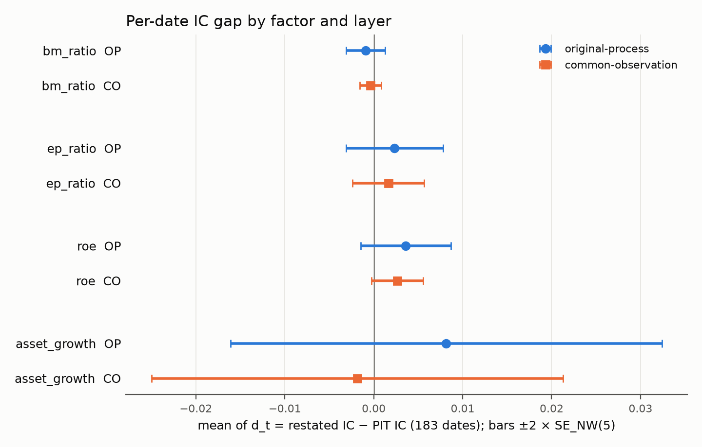

# Research note: vintage layers for the four fundamental factors

DIAGNOSTIC_ONLY. Summary numbers are read from the 2026-09-09 archived run.
Per-date statistics come from a 2026-11-25 recomputation that reproduces that
archive bit for bit (Appendix A). The archive labels its statistics
"NOT findings".

## Key results

- Original-process IC gap (restated − PIT): bm_ratio −0.00092, ep_ratio +0.00235, roe +0.00360, asset_growth +0.00815; only asset_growth exceeds the preconfigured 0.005 trigger, and its `diagnostic_verdict` begins `FAIL`.
- Common-observation IC gap: asset_growth −0.00187 (opposite sign to its original-process gap); bm_ratio −0.00035, ep_ratio +0.00165, roe +0.00265 (same sign as original-process).
- Of the 8 per-date gap tests, two-sided NW(5) p ranges from 0.068 (roe, common-observation) to 0.872 (asset_growth, common-observation), none below 0.05; asset_growth's MDE is 0.0339 and 0.0324, against 0.0017–0.0077 for the other six.

## Question and answer

TODO (author).

## Data and settings

- **Source run.** [`examples/outputs/b_selected_200_rerun_20260909/demo_run.json`](../examples/outputs/b_selected_200_rerun_20260909/demo_run.json),
  `generated_at_utc` 2026-09-11T10:51:10Z.
- **Store.** `data/fza_200.duckdb` (`database_bytes_unchanged` is `true`).
- **Companies.** 200 stored securities (`selected_roster`, 200 rows; 161
  `us-gaap` in `data_summary.securities_usgaap`). `roster_scope` is
  `stored_selection_not_verified_historical_membership`.
- **Dataset status.** `evidence.declared_run_purpose` = `diagnostic_scale`;
  `evidence.declared_research_evidence` = `false`;
  `evidence.declared_survivorship_prone_share` = `1.0`;
  `evidence.statistics_status` = `DIAGNOSTIC_ONLY`.
- **Grid and protocol** (`configuration`). 185 month-end signal dates,
  2011-04-30 to 2026-08-31, not subsampled; 21-session labels; execution lag 1
  session; 5 quantiles; `ls_sharpe_units` = `per_observation_not_annualised`.
  IC is the per-date Spearman rank correlation between signal and forward
  return (`src/fza/pipeline/protocol.py`, `information_coefficient`);
  `ic_mean` is its mean over dates. For each of the four factors and each layer
  below, PIT and restated IC are computed on 183 dates, and the two date lists
  are identical (`…metrics.ic.identical_metric_dates` = `true`).
- **Environment** (`environment`). Python 3.12.14, pandas 3.0.5, numpy 2.5.2,
  scipy 1.18.1; `lock_status` = `MATCHED`.
- **Arms.** PIT reads fundamentals through the point-in-time path. The restated
  arm substitutes a read that keeps `period_end <= signal date` and drops the
  filing-visibility constraint (`src/fza/pipeline/run.py`, `compare_vintages`).
  IC gap = restated IC − PIT IC.
- **Layers.** Defined in [VINTAGE_COMPARISON.md](VINTAGE_COMPARISON.md):
  original-process (shared dates, arm-specific observations and cleaning
  inputs), common-observation (intersection of the cleaned scoring keys),
  common-support (intersection of finite, post-membership, pre-cleaning keys,
  re-cleaned per arm). All three are diagnostic; differences between layers are
  sensitivities, not a value/sample decomposition.
- **Cleaning setting.** The common-support cleaning reports record
  `neutralised: false` for both arms of all four factors
  (`…layers.common-support.cleaning[0..1].neutralised`).
- **Recomputation.** The per-date IC series come from a 2026-11-25
  recomputation on the same store, which reproduces the archive bit for bit
  (Appendix A).

## Four-factor table

All rows: status `DIAGNOSTIC_ONLY`, label/holding-period identity `MATCHED`.

| factor | layer | PIT IC | restated IC | IC gap | restated-only share |
|---|---|---|---|---|---|
| bm_ratio | original-process | −0.01400 | −0.01493 | −0.00092 | 0.96% (195 / 20,346) |
| bm_ratio | common-observation | −0.01430 | −0.01465 | −0.00035 | — |
| ep_ratio | original-process | −0.01058 | −0.00823 | +0.00235 | 2.17% (439 / 20,215) |
| ep_ratio | common-observation | −0.00880 | −0.00715 | +0.00165 | — |
| roe | original-process | −0.00471 | −0.00112 | +0.00360 | 2.58% (553 / 21,463) |
| roe | common-observation | −0.00470 | −0.00205 | +0.00265 | — |
| asset_growth | original-process | −0.01166 | −0.00351 | +0.00815 | 42.59% (9,643 / 22,642) |
| asset_growth | common-observation | −0.01120 | −0.01306 | −0.00187 | — |

Field paths, with `<f>` the row's factor and `<layer>` the row's layer, all
under `vintage_comparisons.<f>.detail` in the source run:

| column | field path |
|---|---|
| PIT IC | `layers.<layer>.pit.ic_mean` |
| restated IC | `layers.<layer>.restated.ic_mean` |
| IC gap | `layers.<layer>.ic_gap` |
| restated-only share | `sample_comparison.restated_only_observations` / `sample_comparison.restated_observations` |

Common-observation scores only the shared keys, so it has no restated-only
observations by construction.

Observation counts (`sample_comparison`):

| factor | PIT | restated | shared | PIT-only | restated-only |
|---|---|---|---|---|---|
| bm_ratio | 20,186 | 20,346 | 20,151 | 35 | 195 |
| ep_ratio | 19,908 | 20,215 | 19,776 | 132 | 439 |
| roe | 20,970 | 21,463 | 20,910 | 60 | 553 |
| asset_growth | 13,404 | 22,642 | 12,999 | 405 | 9,643 |

## Per-date statistics

d_t = restated IC − PIT IC on date t, over the 183 IC dates shared by both
arms. The mean of d_t equals the layer's `ic_gap` to within 4 × 10⁻¹⁸.

- **Main test: two-sided**, on NW(5) t. A restatement can make IC better or
  worse, and there was no prior reason to rule out a negative gap. The
  one-sided p (H1: restated − PIT > 0) is given for reference only.
- **t-statistics.** Simple t = mean / (sd / √n), with sd using n − 1. NW(L) t
  uses Newey-West Bartlett weights with lag L and autocovariances divided by
  n; lag 5 is the main lag. NW(0) t differs from simple t only by dividing the
  variance by n instead of n − 1.
- **p-values.** From NW(5) t under a standard normal approximation.
- **Multiple tests.** Eight tests (four factors × two layers). Bonferroni
  threshold: p < 0.05 / 8 = 0.00625, i.e. |NW(5) t| > 2.734 two-sided or
  NW(5) t > 2.498 one-sided. The p-values below are not adjusted.
- **MDE.** Approximate minimum detectable difference at two-sided 5% and 80%
  power, normal approximation: MDE = 2.8 × SE_NW, with SE_NW = √(LRV / n),
  the Newey-West standard error at lag 5 computed directly from the
  Bartlett-weighted long-run variance LRV (NW(5) t = mean / SE_NW), and
  2.8 ≈ 1.96 + 0.84.

| factor | layer | n | sign | mean d | sd d | simple t | NW(5) t | SE_NW | MDE | p two-sided | p one-sided |
|---|---|---|---|---|---|---|---|---|---|---|---|
| bm_ratio | original-process | 183 | − | −0.000925 | 0.016596 | −0.754 | −0.841 | 0.001099 | 0.00308 | 0.400 | 0.800 |
| bm_ratio | common-observation | 183 | − | −0.000351 | 0.009484 | −0.500 | −0.580 | 0.000605 | 0.00169 | 0.562 | 0.719 |
| ep_ratio | original-process | 183 | + | +0.002349 | 0.034611 | +0.918 | +0.859 | 0.002734 | 0.00765 | 0.390 | 0.195 |
| ep_ratio | common-observation | 183 | + | +0.001645 | 0.027677 | +0.804 | +0.820 | 0.002007 | 0.00562 | 0.412 | 0.206 |
| roe | original-process | 183 | + | +0.003597 | 0.033474 | +1.454 | +1.421 | 0.002532 | 0.00709 | 0.155 | 0.078 |
| roe | common-observation | 183 | + | +0.002650 | 0.024319 | +1.474 | +1.823 | 0.001454 | 0.00407 | 0.068 | 0.034 |
| asset_growth | original-process | 183 | + | +0.008153 | 0.169595 | +0.650 | +0.673 | 0.012122 | 0.03394 | 0.501 | 0.251 |
| asset_growth | common-observation | 183 | − | −0.001866 | 0.170322 | −0.148 | −0.161 | 0.011567 | 0.03239 | 0.872 | 0.564 |

Newey-West t by lag:

| factor | layer | NW(0) t | NW(3) t | NW(5) t | NW(12) t |
|---|---|---|---|---|---|
| bm_ratio | original-process | −0.756 | −0.830 | −0.841 | −0.803 |
| bm_ratio | common-observation | −0.501 | −0.556 | −0.580 | −0.541 |
| ep_ratio | original-process | +0.921 | +0.875 | +0.859 | +0.888 |
| ep_ratio | common-observation | +0.806 | +0.798 | +0.820 | +0.839 |
| roe | original-process | +1.458 | +1.414 | +1.421 | +1.419 |
| roe | common-observation | +1.478 | +1.645 | +1.823 | +1.901 |
| asset_growth | original-process | +0.652 | +0.653 | +0.673 | +0.725 |
| asset_growth | common-observation | −0.149 | −0.155 | −0.161 | −0.154 |

Mean of d_t for each factor and layer, with error bars of ±2 × SE_NW(5)
(OP = original-process, CO = common-observation).

Source: `examples/outputs/research_note_20261125/check_<f>.txt`, part 2,
computed from `<f>_series.json` fields `series.<layer>/pit.{dates,ic}` and
`series.<layer>/restated.{dates,ic}`; the figure from the same fields
(Appendix A).

## asset_growth

The original-process directional trigger fired: `diagnostic_verdict` begins
`FAIL`, with `detail.material_gap_threshold` 0.005 and `detail.threshold_kind`
`PRECONFIGURED_DIAGNOSTIC_NOT_SIGNIFICANCE_TEST`. Universe rows excluded:
PIT 213, restated 236 (`detail.universe_rows_excluded_pit`, `…_restated`).

Each arm, by layer (`detail.layers.<layer>.<arm>.*`):

| arm | layer | observations | IC mean | IC std | avg names per quantile |
|---|---|---|---|---|---|
| PIT | original-process | 13,404 | −0.01166 | 0.1878 | 14.7 |
| PIT | common-observation | 12,999 | −0.01120 | 0.1911 | 14.3 |
| restated | original-process | 22,642 | −0.00351 | 0.1614 | 24.7 |
| restated | common-observation | 12,999 | −0.01306 | 0.1877 | 14.3 |

- PIT arm: from original-process to common-observation, the 405 PIT-only
  observations leave the scored sample; IC mean is −0.01166 and then −0.01120.
- Restated arm: from original-process to common-observation, the 9,643
  restated-only observations leave the scored sample; IC mean is −0.00351 and
  then −0.01306.
- IC gap by layer: original-process +0.00815; common-observation −0.00187.
  LS-Sharpe gap by layer (`ls_sharpe_gap`, per observation): +0.1094; +0.0534.
- In common-observation, the sd of the per-date IC gap is 0.1703: 6.2, 7.0
  and 18.0 times the common-observation sd of ep_ratio (0.0277), roe (0.0243)
  and bm_ratio (0.0095) (Per-date statistics).

The two layers' gaps are reported side by side; they are not combined.

## Common-support versus common-observation

For all four factors the common-support IC gap agrees with the
common-observation IC gap to four decimal places (bm_ratio −0.00036,
ep_ratio +0.00163, roe +0.00265, asset_growth −0.00188 at
`layers.common-support.ic_gap`), and the stored LS-Sharpe gaps of the two layers
are equal, in a run where neutralisation was off (`neutralised: false`).

## Conclusion

TODO (author).

## What this cannot show

- **Significance from the archive alone.** The 2026-09-09 archive stores no
  per-date IC series, only date lists and summaries. The per-date statistics
  above come from the recomputation. The 0.005 threshold is a preconfigured
  diagnostic trigger, not a test.
- **Multiple-testing control.** The per-date statistics are eight tests (four
  factors × two layers). The reported p-values are not adjusted; the
  Bonferroni threshold for eight tests (0.00625) is stated alongside them.
- **Absence of an effect.** A t-statistic that is not significant does not
  show that the gap is zero.
- **Power for asset_growth.** Its approximate MDE is 0.0339 (original-process)
  and 0.0324 (common-observation), against 0.0017–0.0077 for the other three
  factors; the asset_growth tests have low power.
- **A decomposition.** Layer gaps are not value and sample parts and are not
  added or subtracted ([VINTAGE_COMPARISON.md](VINTAGE_COMPARISON.md)).
- **A pure restatement effect.** The restated arm relaxes filing visibility, so
  the gap mixes value, availability and processing changes.
- **A cohort or market-wide result.** The common set is selected. The store is
  `diagnostic_scale` with `declared_research_evidence: false` and
  `declared_survivorship_prone_share: 1.0`; the roster is not verified
  historical membership. Research gates (`research_gates`):
  historical membership and terminal outcomes `UNRESOLVED`; post-publication
  out-of-sample, multiple testing, free baseline and trading costs
  `NOT_IMPLEMENTED`.
- **Industry-neutralised behaviour.** Neutralisation was off in this run.
- **Generality across factors.** There are four fundamental factors; the other
  six are `NOT_APPLICABLE` on every layer.

## Appendix A: reproduction

Commands, run logs, file hashes and the committed-script reproduction check
are in [research_note_20261125/README.md](../examples/outputs/research_note_20261125/README.md).

- **Identities.** Source run SHA-256 `4bcefb56…4c4f34`. The presentation replay
  [`b_selected_200_presentation_20260912_final/replay_input.json`](../examples/outputs/b_selected_200_presentation_20260912_final/replay_input.json)
  carries an identical `vintage_comparisons` object (checked 2026-11-24).
  Store SHA-256 `66c60785…12d9` (`database_sha256_after_run`).
- **Recomputation.** On 2026-11-25 the current code (commit `c4840f1`; `src/`
  identical to `main` at `b3d6c35`) recomputed `compare_vintages` for the four
  factors on the same store (same SHA-256, unchanged by the runs), one factor
  per process. The current code reproduces the archive bit for bit for all
  four factors, all three layers and both arms: each arm's `ic_mean`,
  `n_dates`, `n_observations` and IC date list, and each layer's `ic_gap`,
  differ from the archived values by exactly zero (`check_<f>.txt`, part 1,
  produced by
  [`scripts/research_note/check_vintage_series.py`](../scripts/research_note/check_vintage_series.py)).
  The 0.2.0 window correction applies to `mom_12_1`, `mom_6_1` and `rev_1m`
  only ([CHANGELOG.md](../CHANGELOG.md)).
- **Figure.** `research_note_ic_gaps.png` is written by
  [`scripts/research_note/plot_ic_gaps.py`](../scripts/research_note/plot_ic_gaps.py),
  which takes its statistics from the same checker, run with matplotlib
  3.11.2 (Python 3.12.10; matplotlib is not in the locked environment):
  `python -I scripts/research_note/plot_ic_gaps.py examples/outputs/research_note_20261125 docs/research_note_ic_gaps.png`.

Source run fields: `examples/outputs/b_selected_200_rerun_20260909/demo_run.json`.

| item | field path |
|---|---|
| per-layer PIT / restated summaries | `vintage_comparisons.<f>.detail.layers.<layer>.{pit,restated}` |
| per-layer gaps | `vintage_comparisons.<f>.detail.layers.<layer>.{ic_gap,ls_sharpe_gap}` |
| per-layer status and reason | `vintage_comparisons.<f>.detail.layers.<layer>.{status,reason}` |
| outcome identity | `vintage_comparisons.<f>.detail.layers.<layer>.outcome_identity.status` |
| IC date lists | `vintage_comparisons.<f>.detail.layers.<layer>.metrics.ic.{pit_dates,restated_dates,identical_metric_dates}` |
| layer sample counts | `vintage_comparisons.<f>.detail.layers.<layer>.sample.*` |
| common-support cleaning and labels | `vintage_comparisons.<f>.detail.layers.common-support.{cleaning_input_sample,cleaning,label_join}` |
| arm sample comparison | `vintage_comparisons.<f>.detail.sample_comparison.*` |
| verdict and threshold | `vintage_comparisons.<f>.diagnostic_verdict`, `….detail.{material_gap_threshold,threshold_kind}` |
| universe exclusions | `vintage_comparisons.<f>.detail.universe_rows_excluded_{pit,restated}` |
| store identity | `database_sha256_after_run`, `database_bytes_unchanged`, `evidence.*` |
| grid and protocol | `configuration.*` |
| environment | `environment.*` |
| research gates | `research_gates.*` |

Recomputation fields: `examples/outputs/research_note_20261125/`.

| item | file and field path |
|---|---|
| per-date IC series | `<f>_series.json`: `series.<layer>/<arm>.{dates,ic}` |
| recomputed summaries | `<f>_series.json`: `series.<layer>/<arm>.{ic_mean,n_dates,n_observations}`, `layer_ic_gap.<layer>` |
| store hash before and after | `<f>_series.json`: `db_sha256_before`, `db_sha256_after` |
| archive comparison | `check_<f>.txt`, part 1 |
| per-date statistics | `check_<f>.txt`, part 2 |
| run stages, interpreter, code | `<f>_run.log` |

`<f>` ∈ {`bm_ratio`, `ep_ratio`, `roe`, `asset_growth`}; `<layer>` ∈
{`original-process`, `common-observation`, `common-support`}; `<arm>` ∈
{`pit`, `restated`}.
